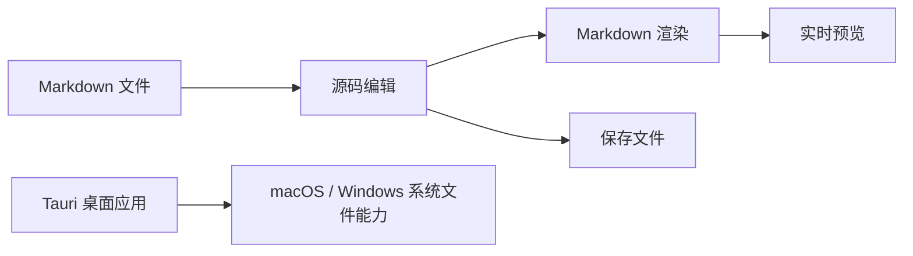

<h1 align="center">Hi, I'm hy123 👋</h1>

  高级计算机视觉工程师 · Senior Computer Vision Engineer 
  深圳 · Shenzhen

  <a href="https://bytewize.cc/">个人网站</a>
  &nbsp;·&nbsp;
  <a href="https://github.com/hy123-pixel?tab=repositories">全部项目</a>

---

### About

专注计算机视觉与工程实践，也喜欢把日常开发中的小问题做成好用的工具。最近主要在做 Swift / macOS 应用、Apple 平台开发工具和跨平台桌面应用。

### Selected projects

| Project | What it does | Built with |
| --- | --- | --- |
| [MemoryBar](https://github.com/hy123-pixel/MemoryBar) | macOS 菜单栏内存监视器：按应用查看用量，按需结束占用较高的应用 | Swift, SwiftUI |
| [CodexQuotaMenu](https://github.com/hy123-pixel/CodexQuotaMenu) | 在 macOS 菜单栏查看 Codex 额度与重置时间 | Swift, SwiftUI |
| [MdPreviewApp](https://github.com/hy123-pixel/MdPreviewApp) | 面向 macOS 与 Windows 的 Markdown 桌面编辑器，支持实时预览、目录导航、数学公式和 Mermaid 图表 | Tauri, Vue, TypeScript |
| [NexaShell](https://github.com/hy123-pixel/NexaShellApp) | 跨平台 SSH 运维客户端，集成终端、SFTP、服务器监控、AI 助手、网络诊断与端口转发 | Tauri 2, Vue 3, Rust |
| [ChronoKit](https://github.com/hy123-pixel/ChronoKit) | 日期、时区、时间戳与业务日处理工具库 | Swift |
| [PulseCN](https://github.com/hy123-pixel/PulseCN) | Pulse 日志框架的中文维护版：记录应用日志与 URLSession 网络事件，可集成到 iOS / iPadOS 应用 | Swift, SwiftUI |
| [PulsePro](https://github.com/hy123-pixel/PulsePro) | 配套 macOS 日志工作台：接收移动设备实时日志，分析网络请求，并打开或导出本地日志包 | Swift, SwiftUI |

### MemoryBar

点击菜单栏即可查看系统内存和应用占用；应用辅助进程会按应用归组，内存数据只在本机采集。

  

Usage: check menu bar memory → open the app list → select an app → end it from the context menu.

  

### MdPreviewApp

用于写作、阅读和整理 Markdown 文档。可在源码编辑、实时预览和分屏模式之间切换，并支持文件树、文章目录、代码高亮、数学公式与 Mermaid 图表。提供 macOS 和 Windows 安装包。

### NexaShell

跨平台 SSH 运维终端客户端，集成 SSH 终端、SFTP 文件管理、服务器监控、AI 运维助手、网络诊断与端口转发。提供 macOS 和 Windows 安装包。

  

  

<a href="https://github.com/hy123-pixel/NexaShellApp">查看项目与下载</a>

### PulseCN + PulsePro

PulseCN 为 Apple 平台应用提供本地日志、URLSession 请求记录和集成式调试控制台；PulsePro 在 macOS 上接收设备发送的实时日志，并检查网络请求详情、会话和本地日志包。

  

<a href="https://github.com/hy123-pixel/PulseCN">PulseCN 框架</a> · <a href="https://github.com/hy123-pixel/PulsePro">PulsePro 桌面端</a> · <a href="https://github.com/hy123-pixel/PulsePro/releases/tag/v0.1.0">下载 PulsePro</a>

### Technologies

`Swift` · `SwiftUI` · `Computer Vision` · `macOS` · `iOS` · `Tauri` · `Vue` · `TypeScript`

---

Build useful things, keep making them better.

